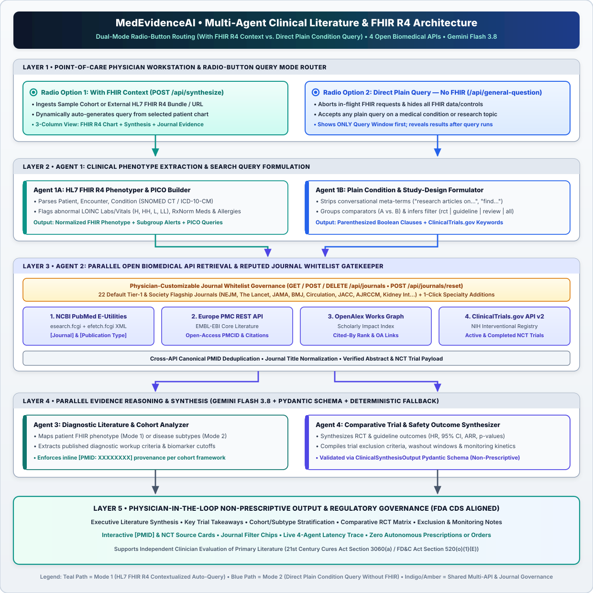
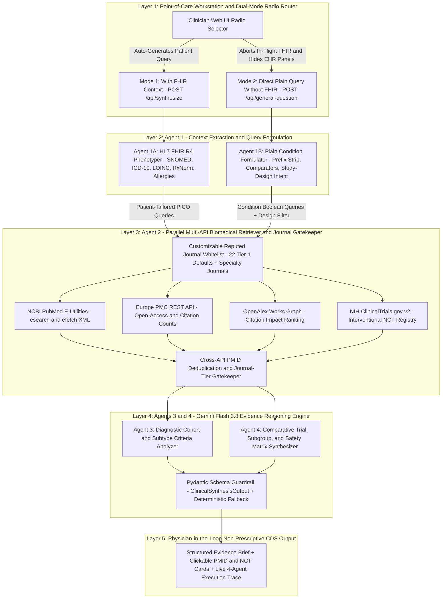

# MedEvidenceAI • Dual-Mode HL7 FHIR R4 & Direct Plain-Query Multi-Agent Clinical Literature Copilot

**Core Reasoning Engine:** Gemini Flash 3.8 (`gemini-3.8-flash`) with Structured Clinical Schema Enforcement & Deterministic Synthesis Fallback  
**Documentation:** [Step-by-Step User Guide (`docs/USER_GUIDE.md`)](docs/USER_GUIDE.md)

**MedEvidenceAI** is a physician-led, non-prescriptive **Point-of-Care Clinical Research & Literature Synthesis Copilot**. It bridges electronic health record interoperability (**HL7 FHIR R4**) with live, verifiable retrieval across **four open-source biomedical research APIs**—**NCBI PubMed Entrez E-Utilities**, **Europe PMC**, **OpenAlex**, and **NIH ClinicalTrials.gov API v2**—strictly bounded by a physician-governed whitelist of high-impact, peer-reviewed medical journals.

MedEvidenceAI features a **Dual-Mode Radio-Button Clinical Inquiry Architecture** inside a unified Point-of-Care Workstation:
1. **With FHIR Context (Auto-Generated Patient Query):** Parses structured HL7 FHIR R4 patient bundles (`Patient`, `Encounter`, `Condition`, `Observation`, `MedicationStatement`, `AllergyIntolerance`) and dynamically auto-generates a patient-specific clinical literature query from active SNOMED CT / ICD-10-CM diagnoses, abnormal LOINC laboratory/vital flags, RxNorm medications, and drug allergies.
2. **Direct Query Without FHIR Context (Plain Condition & Research Article Lookup):** Enables physicians to independently query peer-reviewed research articles and registered `NCT` clinical trials on any condition using a single **plain-language query**—enforcing strict FHIR data isolation (aborting in-flight FHIR tasks, clearing patient DOM state, and displaying **only** the centered Query Window until the physician submits a query, after which synthesized findings and verified journal sources are revealed).

> [!IMPORTANT]
> **Physician-in-the-Loop Governance:** MedEvidenceAI never issues autonomous diagnostic directives, prescriptions, or clinical orders. Every synthesized finding exposes inline, clickable `[PMID]` and `NCT` identifiers so the evaluating physician can independently inspect underlying trial cohorts, hazard ratios, confidence intervals, and exclusion criteria.

---

## Clinical Problem Statement & Motivation

Point-of-care clinicians face two distinct evidence retrieval bottlenecks during clinical workflows:
- **Patient-Contextualized Complexity:** Translating a multimorbid patient chart—such as concurrent HFrEF, Stage 3b chronic kidney disease, borderline hyperkalemia, and ACE-inhibitor angioedema—into precision Boolean literature queries requires manual extraction of phenotypes, laboratory thresholds, and subgroup exclusion criteria under severe time constraints [1, 2].
- **Independent Condition Literature Lookup:** Physicians frequently need to step outside a specific patient chart to review landmark randomized controlled trials (RCTs), society practice guidelines, or systematic reviews on a disease entity using plain clinical phrasing—without patient EHR context biasing retrieval or cluttering the interface.
- **Evidence Provenance & Hallucination Risk:** General-purpose conversational LLMs risk citing non-peer-reviewed web pages or fabricating citations when unconstrained by primary bibliographic indices [3, 4].

MedEvidenceAI resolves both workflows within one workstation by combining **deterministic bibliographic retrieval** across curated medical journals with **structured multi-agent synthesis**.

---

## Dual-Mode Radio-Button Inquiry Architecture

At the top of the workstation inquiry card ([`static/index.html`](static/index.html)), physicians select between two mutually exclusive radio-button modes (`name="clinicalQueryMode"`):

| Dimension | Mode 1: With FHIR Context (`value="fhir"`) | Mode 2: Direct Query Without FHIR Context (`value="direct"`) |
| :--- | :--- | :--- |
| **Primary Use Case** | Patient-contextualized subgroup & trial parallel synthesis | Independent condition / topic research article lookup |
| **Query Input Mechanism** | Auto-generated dynamically from selected FHIR R4 patient (editable) | Single plain-text query for any condition or clinical topic |
| **FHIR Data Visibility** | Displays Cohort Selector, Import Modal & Left FHIR R4 Chart Panel | All FHIR controls, banners, charts & patient data strictly hidden |
| **Pre-Query Screen State** | 3-Column Workstation (FHIR Chart + Synthesis + Journal Evidence) | **Query-Window-Only** centered view; result panels hidden until run |
| **Post-Query Screen State** | 3-Column Workstation synchronized to selected patient | 2-Column Results View (Synthesis + Verified Articles & `NCT` Trials) |
| **In-Flight Race Protection** | `AbortController` + request sequence guard (`pipelineRequestSeq`) | Immediately aborts any in-flight FHIR request & clears DOM on toggle |
| **Primary REST Endpoint** | `POST /api/synthesize` | `POST /api/general-question` (also supports `POST /api/condition-research`) |

### 1. Mode 1: With FHIR Context & Dynamic Patient Auto-Query Generation
When **With FHIR Context** is active, `parse_fhir_bundle` in [`backend/fhir_parser.py`](backend/fhir_parser.py) extracts normalized clinical entities across standard terminologies—**HL7 FHIR R4** [5], **SNOMED CT** [6, 7], **ICD-10-CM** [7], **LOINC** [8], and **RxNorm** [9]—and invokes `generate_patient_auto_query` to construct:
- A primary **auto-generated clinical research query** incorporating patient age/sex, top active diagnoses, abnormal laboratory/vital observations (`H`, `HH`, `L`, `LL`), active medications, and high-criticality drug allergies.
- Up to three **patient-specific follow-up question chips** targeting comorbidity subgroup outcomes, laboratory safety thresholds, and allergy-related pharmacological transitions.

Switching patients in the cohort selector (`#caseSelect`) or importing an external FHIR R4 Bundle (`POST /api/parse-fhir`) automatically regenerates the query and refreshes literature synthesis.

### 2. Mode 2: Direct Plain-Query Condition Lookup & Strict Context Isolation
Selecting the **Direct Query (Without FHIR Context)** radio button triggers strict UI and state isolation in [`static/app.js`](static/app.js):
1. **Immediate FHIR Purge & Cancellation:** `abortActivePipeline` cancels any active FHIR synthesis `fetch` via `AbortController`, `clearResultsDom` clears rendered patient synthesis/article nodes, and all FHIR UI containers (`#fhirHeaderControls`, `#panelLeftFhir`, `#autoQueryStatusRow`) are hidden.
2. **Progressive Disclosure (Query Window First, Results After Query):** `setDirectQueryResultsState("query-only")` hides `#agentTraceSection`, `#synthesisResultsContainer`, and `#panelRightArticles`, presenting **only** the centered plain-query window (`.workstation-grid.direct-query-only`). Results and retrieved journal cards render exclusively after the physician submits a plain query.
3. **Plain-Language Condition Extraction & Study-Design Inference:** In `_build_general_question_queries` and `_infer_pub_type_from_plain_query` ([`backend/agent_orchestrator.py`](backend/agent_orchestrator.py)):
   - Conversational and meta-search tokens (*"research"*, *"articles"*, *"papers"*, *"find"*, *"condition"*, *"about"*, etc.) are stripped so plain queries such as `"research articles on acute pericarditis"` cleanly isolate `"acute pericarditis"`.
   - Comparator expressions (`tenecteplase vs alteplase`) are transformed into parenthesized Boolean clauses: `(tenecteplase OR alteplase) AND (acute ischemic stroke)`.
   - Study-design intent is automatically inferred when a single design class is requested: `rct` (randomized/controlled trials), `guideline` (practice guidelines/consensus), `review` (systematic reviews/meta-analyses), or `all`.

---

## Agentic Approach & Multi-Agent System Architecture

`MedEvidenceAI` implements a **5-layer sequential-and-parallel multi-agent pipeline** orchestrated in [`backend/agent_orchestrator.py`](backend/agent_orchestrator.py) and [`backend/pubmed_journal_tool.py`](backend/pubmed_journal_tool.py). Rather than relying on a single monolithic prompt, clinical reasoning is decomposed across specialized agents with strict input/output contracts, live open-access biomedical tool execution, journal-tier gatekeeping, and schema-validated synthesis.



### Layered Agentic Workflow Diagram



### Agent Roles, Handoff Contracts, and Guardrails

| Pipeline Stage | Agent / Component | Input Contract | Core Reasoning & Tool Action | Output Handoff |
| :--- | :--- | :--- | :--- | :--- |
| **Layer 1** | **Dual-Mode Radio Router** ([`static/app.js`](static/app.js)) | Physician radio selection (`fhir` vs. `direct`) | Routes to `/api/synthesize` or `/api/general-question`; triggers `AbortController` and hides FHIR UI elements in Direct mode | Mode-isolated JSON request payload |
| **Layer 2 (FHIR)** | **Agent 1A — FHIR Phenotyper** ([`backend/fhir_parser.py`](backend/fhir_parser.py)) | HL7 FHIR R4 `Bundle` (`Patient`, `Condition`, `Observation`, `MedicationStatement`, `AllergyIntolerance`) | Extracts coded phenotypes, flags abnormal labs (`H`/`HH`/`L`/`LL`), identifies high-risk subgroups (e.g., CKD stage, age, drug allergies), and auto-builds PICO search queries | Structured `PatientClinicalSummary` + targeted Boolean queries |
| **Layer 2 (Direct)** | **Agent 1B — Plain Query Formulator** ([`backend/agent_orchestrator.py`](backend/agent_orchestrator.py)) | Free-text plain condition or clinical topic (`question`, optional `study_focus`) | Strips conversational framing, constructs parenthesized `vs`/`versus` comparator clauses, and infers study-design filter (`rct`, `guideline`, `review`, `all`) | Clean biomedical search clauses + inferred `study_focus` |
| **Layer 3** | **Agent 2 — Multi-API Biomedical Retriever** ([`backend/pubmed_journal_tool.py`](backend/pubmed_journal_tool.py)) | Formulated search clauses + active journal whitelist | Fires concurrent async `httpx` requests across PubMed E-Utilities [10], Europe PMC [11], OpenAlex [12], and ClinicalTrials.gov v2 [13]; enforces journal-tier filtering and cross-API PMID deduplication | Verified corpus of peer-reviewed abstracts (`PMID`) + registered trials (`NCT`) |
| **Layer 4A** | **Agent 3 — Diagnostic & Cohort Analyzer** ([`backend/agent_orchestrator.py`](backend/agent_orchestrator.py)) | Verified abstract corpus + FHIR phenotype (Mode 1) or condition focus (Mode 2) | Maps patient biomarkers or condition subtypes against published society diagnostic criteria and classification frameworks using `gemini-3.8-flash` | Citation-backed `diagnostic_workup_considerations` (`[PMID]`) |
| **Layer 4B** | **Agent 4 — Comparative Trial Synthesizer** ([`backend/agent_orchestrator.py`](backend/agent_orchestrator.py)) | Verified abstract corpus + `NCT` trials + Agent 3 context | Compiles non-prescriptive hazard ratios, 95% CIs, ARR/NNT, trial exclusion/caution profiles, and monitoring schedules; validated via Pydantic `ClinicalSynthesisOutput` with deterministic fallback | Validated `ClinicalSynthesisOutput` + step-by-step `agent_trace` |
| **Layer 5** | **Physician-in-the-Loop CDS Interface** ([`static/index.html`](static/index.html)) | Validated synthesis JSON + citation metadata + `agent_trace` | Renders non-prescriptive synthesis cards, clickable PubMed/Europe PMC/OpenAlex/ClinicalTrials.gov links, and transparent 4-agent execution telemetry | Auditable evidence workspace for independent physician judgment |

---

## Open Biomedical APIs & Customizable Journal Whitelist Governance

### Federated Open-Source Research Sources
1. **NCBI PubMed Entrez E-Utilities (`eutils.ncbi.nlm.nih.gov`):** Executes journal-restricted `esearch.fcgi` Boolean queries with `Publication Type` filtering (`Randomized Controlled Trial`, `Practice Guideline`, `Meta-Analysis`, `Systematic Review`) followed by XML abstract parsing via `efetch.fcgi` [10].
2. **Europe PMC RESTful API (`ebi.ac.uk/europepmc`):** Enriches retrieval with open-access indicators (`isOpenAccess`), `PMCID` full-text availability, and live `citedByCount` metrics [11].
3. **OpenAlex Scholarly Graph (`api.openalex.org/works`):** Queries peer-reviewed medical works sorted by citation impact (`cited_by_count:desc`) using Boolean-sanitized search strings and study-design hints [12].
4. **NIH ClinicalTrials.gov REST API v2 (`clinicaltrials.gov/api/v2/studies`):** Retrieves active, recruiting, and completed interventional clinical trials (`NCT...`) with phase, enrollment status, and direct registry links [13].

### Physician-Customizable Journal Whitelist
By default, retrieval is restricted to **22 Tier-1 general and specialty society flagship journals** (*NEJM*, *The Lancet*, *JAMA*, *The BMJ*, *Annals of Internal Medicine*, *JAMA Internal Medicine*, *Nature Medicine*, *Circulation*, *JACC*, *European Heart Journal*, *JAMA Cardiology*, *AJRCCM*, *Intensive Care Medicine*, *The Lancet Respiratory Medicine*, *The Lancet Infectious Diseases*, *Clinical Infectious Diseases*, *CHEST*, *Kidney International*, *JASN*, *Annals of the Rheumatic Diseases*, *Gastroenterology*, and *Gut*).

Through the interactive **Journals Modal** and REST endpoints (`GET /api/journals`, `POST /api/journals`, `DELETE /api/journals/{journal_id}`, `POST /api/journals/reset`), physicians can:
- Add 1-click specialty journals (*Journal of Clinical Oncology*, *Blood*, *Diabetes Care*, *Stroke*, *Neurology*, *JAMA Neurology*, *JAMA Oncology*, *Hepatology*, *Arthritis & Rheumatology*, *European Respiratory Journal*) or register custom peer-reviewed journals by title/NLM abbreviation.
- Remove journals or restore the 22-journal baseline at any time, dynamically updating PubMed `[Journal]`, Europe PMC `JOURNAL:`, and OpenAlex source matching filters.

---

## Clinical Safety, Regulatory Alignment & Non-Prescriptive Design

MedEvidenceAI is architected in alignment with the **U.S. FDA Guidance on Clinical Decision Support Software** implementing Section 3060(a) of the 21st Century Cures Act (FD&C Act Section 520(o)(1)(E)) [14]:
1. **Non-Signal / Structured EHR & Bibliographic Input:** Processes structured HL7 FHIR R4 clinical records and published peer-reviewed medical literature rather than raw physiological device waveforms or medical images.
2. **Assistive, Non-Directive Output:** System prompts and deterministic fallbacks prohibit imperative prescribing language (*"prescribe"*, *"administer"*, *"start immediately"*), presenting comparative trial arms and guideline evidence classes strictly for clinician evaluation.
3. **Independent Reviewability of Basis:** Every clinical takeaway, diagnostic cohort parallel, and therapeutic trial summary links directly to verifiable PubMed (`PMID`), DOI, and ClinicalTrials.gov (`NCT`) primary records [15, 16].

---

## How to Run

```bash
git clone https://github.com/Sivaram0606/MedEvidenceAI.git
cd MedEvidenceAI
python3 -m venv .venv
.venv/bin/pip install -r requirements.txt

# Optional: Set GEMINI_API_KEY for live Gemini Flash 3.8 synthesis
# (Automatically falls back to deterministic citation-backed synthesis if unset)
export GEMINI_API_KEY="your_api_key_here"

.venv/bin/uvicorn backend.main:app --host 127.0.0.1 --port 8000 --reload
```

Open **`http://127.0.0.1:8000/`** in your browser.

---

## References

1. Ely JW, Osheroff JA, Ebell MH, et al. Analysis of questions asked by family doctors regarding patient care. *BMJ*. 1999;319(7206):358-361. doi:10.1136/bmj.319.7206.358 (PMID: 10435959)
2. Del Fiol G, Workman TE, Gorman PN. Clinical questions raised by clinicians at the point of care: a systematic review. *JAMA Intern Med*. 2014;174(5):710-718. doi:10.1001/jamainternmed.2014.368 (PMID: 24663331)
3. Jin Q, Leaman R, Lu Z. Retrieve, summarize, and verify: how will ChatGPT affect information seeking from the medical literature? *J Am Soc Nephrol*. 2023;34(8):1302-1304. doi:10.1681/ASN.0000000000000166 (PMID: 37254224)
4. Thirunavukarasu AJ, Ting DSJ, Elangovan K, Gutierrez L, Tan TF, Ting DSW. Large language models in medicine. *Nat Med*. 2023;29(8):1930-1940. doi:10.1038/s41591-023-02448-8 (PMID: 37460753)
5. HL7 International. *HL7 Fast Healthcare Interoperability Resources (FHIR) Release 4 (v4.0.1) Specification*. Health Level Seven International; 2019. https://hl7.org/fhir/R4/
6. Mandel JC, Kreda DA, Mandl KD, Kohane IS, Ramoni RB. SMART on FHIR: a standards-based, interoperable apps platform for electronic health records. *J Am Med Inform Assoc*. 2016;23(5):899-908. doi:10.1093/jamia/ocv189 (PMID: 26911829)
7. SNOMED International. *SNOMED CT Clinical Terms Specification*; Centers for Medicare & Medicaid Services / NCHS. *ICD-10-CM Official Guidelines for Coding and Reporting*. https://www.snomed.org/
8. McDonald CJ, Huff SM, Suico JG, et al. LOINC, a universal standard for identifying laboratory observations: a 5-year update. *Clin Chem*. 2003;49(4):624-633. doi:10.1373/49.4.624 (PMID: 12651816)
9. Nelson SJ, Zeng K, Kilbourne J, Powell T, Moore R. Normalized names for clinical drugs: RxNorm at 6 years. *J Am Med Inform Assoc*. 2011;18(4):441-448. doi:10.1136/amiajnl-2011-000116 (PMID: 21515544)
10. Sayers EW, Bolton EE, Brister JR, et al. Database resources of the National Center for Biotechnology Information (NCBI Entrez E-Utilities & PubMed). *Nucleic Acids Res*. 2022;50(D1):D20-D26. doi:10.1093/nar/gkab1112 (PMID: 34850941)
11. Ferguson C, Araújo D, Faulk L, et al. Europe PMC in 2020. *Nucleic Acids Res*. 2021;49(D1):D1507-D1514. doi:10.1093/nar/gkaa994 (PMID: 33180112)
12. Priem J, Piwowar H, Orr R. OpenAlex: A fully-open index of scholarly works, authors, venues, institutions, and concepts. *arXiv preprint arXiv:2205.01833*. 2022. https://openalex.org/
13. Zarin DA, Tse T, Williams RJ, Califf RM, Ide NC. The ClinicalTrials.gov results database—update and key issues (ClinicalTrials.gov REST API v2). *N Engl J Med*. 2011;364(9):852-860. doi:10.1056/NEJMsa1012065 (PMID: 21366476)
14. U.S. Food and Drug Administration (FDA). *Clinical Decision Support Software: Guidance for Industry and Food and Drug Administration Staff*. Center for Devices and Radiological Health (CDRH); September 2022 (Updated January 2026). https://www.fda.gov/regulatory-information/search-fda-guidance-documents/clinical-decision-support-software
15. Richardson WS, Wilson MC, Nishikawa J, Hayward RS. The well-built clinical question: a key to evidence-based decisions (PICO Framework). *ACP J Club*. 1995;123(3):A12-A13. (PMID: 7582737)
16. Guyatt GH, Oxman AD, Vist GE, et al. GRADE: an emerging consensus on rating quality of evidence and strength of recommendations. *BMJ*. 2008;336(7650):924-926. doi:10.1136/bmj.39489.470347.AD (PMID: 18436948)
17. McMurray JJV, Solomon SD, Inzucchi SE, et al. Dapagliflozin in patients with heart failure and reduced ejection fraction (DAPA-HF). *N Engl J Med*. 2019;381(21):1995-2008. doi:10.1056/NEJMoa1911303 (PMID: 31535829)
18. Heidenreich PA, Bozkurt B, Aguilar D, et al. 2022 AHA/ACC/HFSA Guideline for the Management of Heart Failure. *Circulation*. 2022;145(18):e895-e1032. doi:10.1161/CIR.0000000000001063 (PMID: 35363499)
