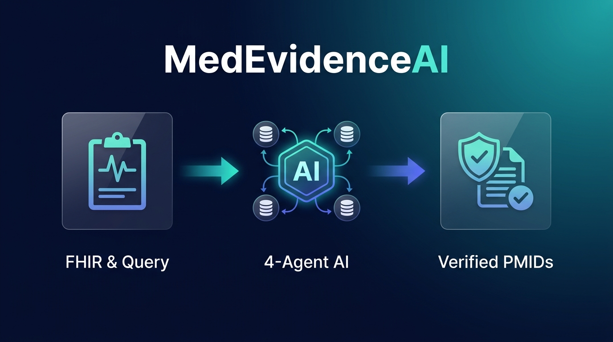
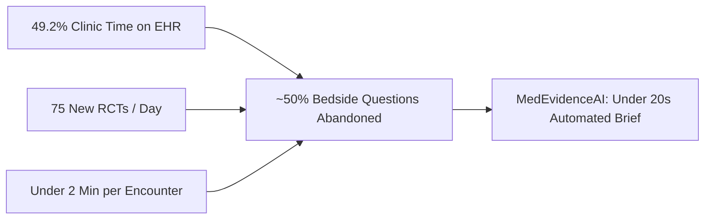
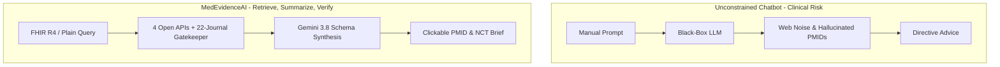
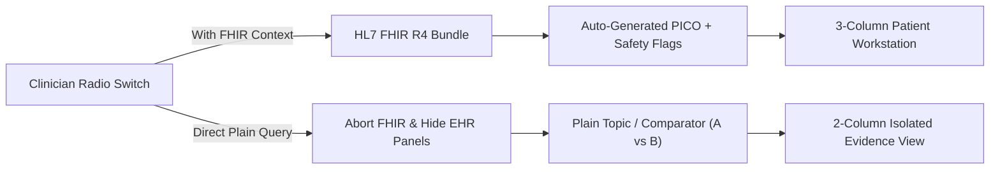
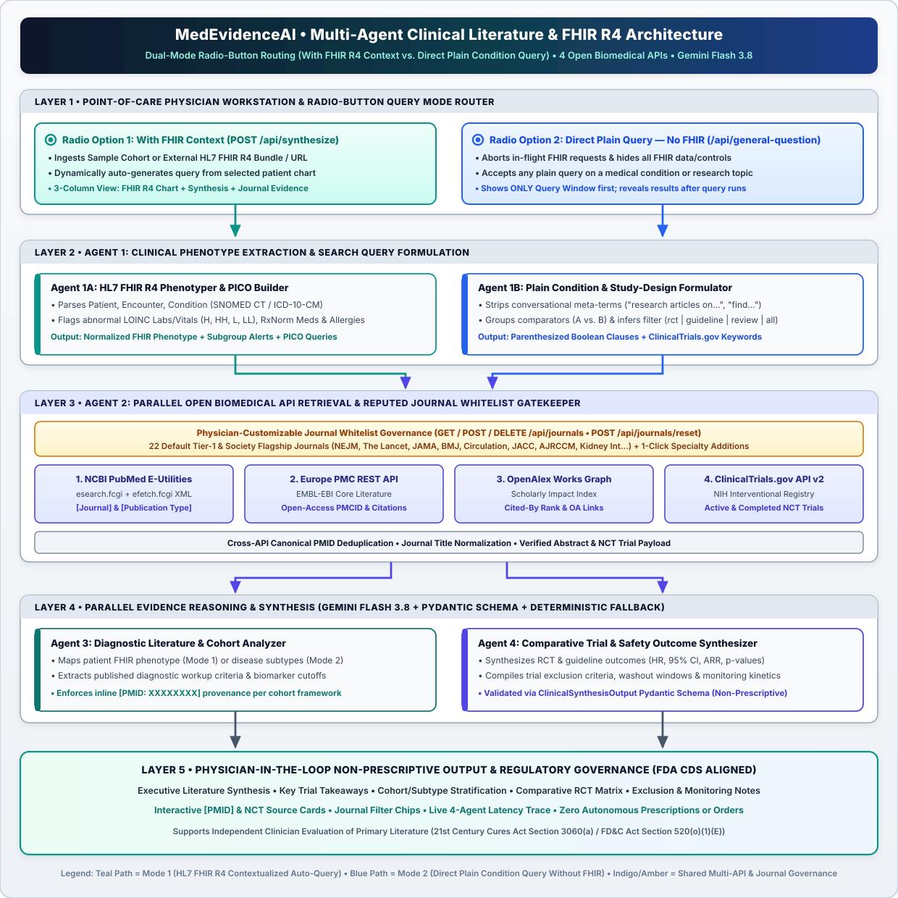
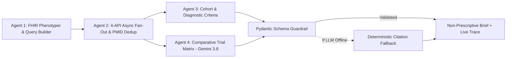
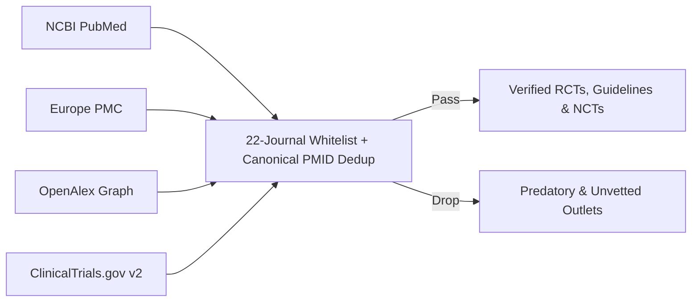
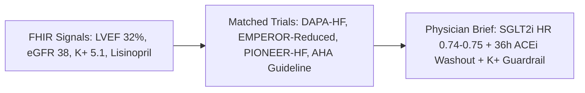
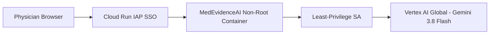

# MedEvidenceAI

**HL7 FHIR R4 + Direct Query  •  4 Open Biomedical APIs  •  22 Flagship Journals  •  Non-Prescriptive CDS**

---

# Slide 2 • The Bedside Evidence Bottleneck

- **78% of bedside questions have published answers** — time friction is the primary barrier.

---

# Slide 3 • Generic Chatbot vs. MedEvidenceAI Flow

---

# Slide 4 • Dual-Mode Clinical Router

---

# Slide 5 • 5-Layer Multi-Agent Block Diagram

---

# Slide 6 • End-to-End 4-Agent Orchestration Flow

---

# Slide 7 • 4 Open APIs & 22-Journal Gatekeeper Funnel

---

# Slide 8 • Multimorbid Case Flow: 64M HFrEF + CKD 3b

- Built-in cohorts span **Cardiology/Nephrology**, **Sepsis/ID**, **AFib + GI Bleed**, and **Lupus Nephritis** + live FHIR import.

---

# Slide 9 • Physician Advantages & Cloud Run Topology

- **Zero EHR Re-Typing** • **Multimorbid Subgroup Precision** • **Zero Fabricated PMIDs** • **FDA-Aligned Non-Directive CDS**

---

# Slide 10 • Key Literature References

1. **Sinsky C, et al.** Allocation of physician time in ambulatory practice (49.2% EHR vs. 27.0% face time). *Ann Intern Med*. 2016;165(11):753-760. (PMID: 27595430)
2. **Del Fiol G, Workman TE, Gorman PN.** Clinical questions raised at the point of care (0.57/pt; ~50% unpursued; 78% answerable). *JAMA Intern Med*. 2014;174(5):710-718. (PMID: 24663331)
3. **Bastian H, Glasziou P, Chalmers I.** Seventy-five trials and eleven systematic reviews a day. *PLoS Med*. 2010;7(9):e1000326. (PMID: 20877712)
4. **Zakka C, et al.** Almanac — Retrieval-augmented language models for clinical medicine. *NEJM AI*. 2024;1(2):AIoa2300068. (PMID: 38343631)
5. **Jin Q, Leaman R, Lu Z.** Retrieve, summarize, and verify in medical literature search. *JASN*. 2023;34(8):1302-1304. (PMID: 37254224)
6. **Goddard K, Roudsari A, Wyatt JC.** Automation bias: mitigators via non-directive CDS. *JAMIA*. 2012;19(1):121-127. (PMID: 21685142)
7. **Cook DA, Del Fiol G, et al.** EHR context-sensitive infobuttons (*JAMIA*. 2017, PMID: 27497794) & **Mandel JC, et al.** SMART on FHIR (*JAMIA*. 2016, PMID: 26911829).
8. **Boyd CM, et al.** Multimorbidity guidelines (*JAMA*. 2005, PMID: 16091574) & **U.S. FDA** *Clinical Decision Support Software Guidance* (Cures Act § 3060(a), 2026).
