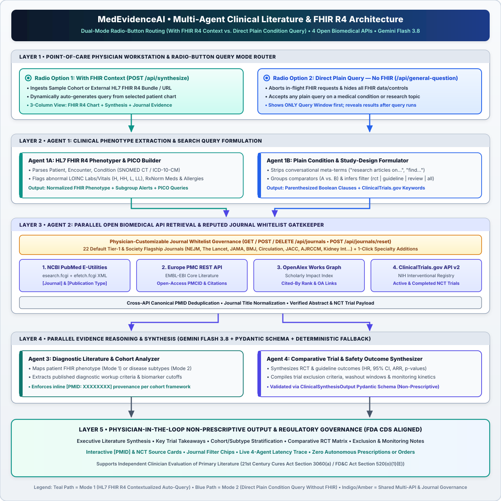

# MedEvidenceAI User Guide

Welcome to the **MedEvidenceAI Point-of-Care Clinical Research & Literature Copilot** User Guide. This guide walks clinicians, clinical informaticists, and developers through setting up the workstation, navigating both inquiry modes (**With FHIR Context** and **Direct Query Without FHIR Context**), importing external HL7 FHIR R4 patient bundles, customizing the peer-reviewed journal whitelist, and calling the REST APIs directly.

> [!IMPORTANT]
> **Clinical Governance & Intended Use:** `MedEvidenceAI` is an **assistive clinical literature research tool** designed for qualified healthcare professionals. It synthesizes published clinical trials, diagnostic criteria, and society guidelines with inline `[PMID]` and `NCT` provenance. It **does not** issue medical orders, prescriptions, or autonomous clinical directives.

---

## Table of Contents
1. [Installation & Quick Start](#1-installation--quick-start)
2. [Workstation Interface Overview](#2-workstation-interface-overview)
3. [Mode 1: With FHIR Context (Patient-Contextualized Inquiry)](#3-mode-1-with-fhir-context-patient-contextualized-inquiry)
4. [Importing or Fetching Custom HL7 FHIR R4 Patient Data](#4-importing-or-fetching-custom-hl7-fhir-r4-patient-data)
5. [Mode 2: Direct Query Without FHIR Context (Plain Condition Lookup)](#5-mode-2-direct-query-without-fhir-context-plain-condition-lookup)
6. [Interpreting & Auditing Synthesis Results](#6-interpreting--auditing-synthesis-results)
7. [Managing the Reputed Medical Journal Whitelist](#7-managing-the-reputed-medical-journal-whitelist)
8. [REST API Quick Reference](#8-rest-api-quick-reference)
9. [Keyboard Shortcuts & Troubleshooting](#9-keyboard-shortcuts--troubleshooting)

---

## 1. Installation & Quick Start

### Prerequisites
- **Python:** `3.10` or higher
- **Internet Connection:** Required for live queries to **NCBI PubMed E-Utilities**, **Europe PMC**, **OpenAlex**, and **NIH ClinicalTrials.gov API v2**
- **Browser:** Modern desktop or tablet web browser (Chrome, Safari, Edge, Firefox)

### Step-by-Step Launch

```bash
# 1. Clone the repository
git clone https://github.com/Sivaram0606/MedEvidenceAI.git
cd MedEvidenceAI

# 2. Create a virtual environment and install dependencies
python3 -m venv .venv
.venv/bin/pip install -r requirements.txt

# 3. (Optional) Configure Gemini Flash 3.8 credentials
export GEMINI_API_KEY="your_gemini_api_key"

# 4. Launch the FastAPI web workstation
.venv/bin/uvicorn backend.main:app --host 127.0.0.1 --port 8000 --reload
```

Open **`http://127.0.0.1:8000/`** in your browser.

### Environment Variables (Optional)

| Variable | Default | Description |
| :--- | :--- | :--- |
| `GEMINI_API_KEY` or `GOOGLE_API_KEY` | *(Unset)* | API key for live Gemini LLM reasoning in Agents 3 & 4. If unset, `MedEvidenceAI` automatically uses Vertex AI ADC if configured, or gracefully falls back to deterministic citation-backed synthesis. |
| `GEMINI_MODEL` | `gemini-3.8-flash` | Model identifier used by Agents 3 and 4 in [`backend/agent_orchestrator.py`](../backend/agent_orchestrator.py). |
| `GOOGLE_CLOUD_PROJECT` | `my-project-ssi-364811` | GCP Project ID when authenticating via Google Cloud Application Default Credentials (ADC). |
| `GOOGLE_CLOUD_LOCATION` | `global` | Vertex AI region when using ADC authentication. |

---

## 2. Workstation Interface Overview



The workstation adapts dynamically to your selected **Query Mode**:

| UI Region | In `With FHIR Context` Mode | In `Direct Query (Without FHIR Context)` Mode |
| :--- | :--- | :--- |
| **Top Header Bar** | Shows **Patient FHIR Cohort** selector, **`+ Import / Fetch FHIR`**, and **`22 Reputed Journals & 4 Open APIs`** button | Hides all FHIR controls; shows only branding and **`22 Reputed Journals & 4 Open APIs`** button |
| **Left Panel** | **Patient HL7 FHIR R4 Context** (Demographics, Subgroup Alerts, Labs & Vitals, Conditions, Meds & Allergies, Raw FHIR JSON) | **Strictly Hidden** (zero patient context displayed or transmitted) |
| **Center Panel** | Radio Mode Selector, Auto-Generated Query Box, 4-Agent Pipeline Trace, and Structured Synthesis Cards | Centered **Query Window Only** prior to search; expands to show Trace + Synthesis Cards after submitting a query |
| **Right Panel** | **Open-Source Research Evidence** (Journal filter chips + retrieved PubMed/Europe PMC/OpenAlex articles & `NCT` trials) | Hidden prior to search; appears alongside Synthesis Cards once a plain query finishes |

---

## 3. Mode 1: With FHIR Context (Patient-Contextualized Inquiry)

Use **With FHIR Context** when evaluating clinical trial parallels, subgroup outcomes, or safety considerations tailored to a specific patient's EHR profile.

### Step 1: Select "With FHIR Context"
At the top of the center Inquiry Card, ensure the **`With FHIR Context`** radio button (*"Auto-generated query from selected patient"*) is selected.

### Step 2: Choose a Patient Cohort
Use the **`Patient FHIR Cohort`** dropdown in the top header to switch among the 4 built-in clinical cases:
1. **`64M • HFrEF (LVEF 32%), Stage 3b CKD (eGFR 38) & T2DM`** — Cardiology / Nephrology multimorbidity with borderline hyperkalemia and ACEi angioedema history.
2. **`71F • Severe CAP, Early Septic Shock & IgE Penicillin Allergy`** — Pulmonology / Critical Care / Infectious Diseases beta-lactam cross-reactivity and severe pneumonia management.
3. **`78F • Non-Valvular AFib (CHA₂DS₂-VASc 6), Prior TIA & Recent Peptic Ulcer Bleed`** — Neurology / Cardiology / GI anticoagulation resumption timing vs. recurrent GI bleed risk.
4. **`34F • Active Class IV Lupus Nephritis, Nephrotic Proteinuria & Hypocomplementemia`** — Rheumatology / Nephrology combination biologic + standard induction regimens.

### Step 3: Review the Left HL7 FHIR R4 Context Panel
- **Patient Banner:** Displays patient name, age, sex, encounter setting, and FHIR ID.
- **Subgroup & Pharmacological Alerts:** Highlights abnormal laboratory values (`H`, `HH`, `L`, `LL`), renal/hepatic dosing thresholds, and severe drug allergies extracted automatically from the bundle.
- **Chart Navigation Tabs:**
  - **`Labs & Vitals`:** LOINC-coded observations with reference flags.
  - **`Conditions`:** Active SNOMED CT / ICD-10-CM diagnoses.
  - **`Meds & Allergies`:** Active `MedicationStatement` / `MedicationRequest` entries and `AllergyIntolerance` records.
  - **`FHIR JSON`:** Inspect the raw underlying HL7 FHIR R4 JSON bundle.

### Step 4: Inspect or Edit the Auto-Generated Query
- Whenever you select or import a patient, `MedEvidenceAI` automatically populates the query box with a **patient-specific clinical query** derived from their active diagnoses, abnormal labs, medications, and allergies.
- **Follow-Up Chips:** Click any of the suggested question chips above the text box to pivot toward a specific clinical question for that patient.
- **Restore Auto-Query:** If you manually edit the text box and want to return to the patient's baseline auto-generated query, click **`↻ Auto-Generate Query`**.

### Step 5: Synthesize Evidence
Click **`Synthesize Research Evidence`** (or press `Enter`). The 4-agent pipeline will formulate targeted queries, retrieve peer-reviewed journal abstracts and `NCT` clinical trials, and render patient-contextualized synthesis cards.

---

## 4. Importing or Fetching Custom HL7 FHIR R4 Patient Data

You can load external HL7 FHIR R4 patient records in **With FHIR Context** mode:

1. Click **`+ Import / Fetch FHIR`** in the top header bar to open the **Import or Fetch HL7 FHIR R4 Patient Bundle** modal.
2. Choose either import method:
   - **Option 1 — Fetch from External FHIR R4 REST Endpoint URL:** Enter a public or local FHIR R4 URL (for example, `https://hapi.fhir.org/baseR4/Patient/example` or a Bundle endpoint) and click **`Fetch URL`**. The fetched JSON will populate the preview editor.
   - **Option 2 — Upload or Paste HL7 FHIR R4 Bundle JSON:** Select a `.json` file from disk using the file picker, or paste a raw `"resourceType": "Bundle"` (or `"Patient"`) JSON payload directly into the editor.
3. Click **`Parse & Load Patient FHIR Context`**.
4. `MedEvidenceAI` parses the bundle, updates the Left Panel chart tabs, auto-generates a tailored clinical research query for the imported patient, and runs the synthesis pipeline.

---

## 5. Mode 2: Direct Query Without FHIR Context (Plain Condition Lookup)

Use **Direct Query (Without FHIR Context)** when you want to independently research a medical condition, therapeutic comparison, or society guideline without any patient EHR context.

### Step 1: Select "Direct Query (Without FHIR Context)"
Click the **`Direct Query (Without FHIR Context)`** radio button (*"Plain query for research articles on any condition"*).
- Any in-flight FHIR synthesis request is immediately cancelled.
- All FHIR patient panels, banners, and cohort selectors are hidden.
- Only the clean, centered **Query Window** is displayed until you run your search.

### Step 2: Enter a Plain Clinical Query
Type any condition, intervention comparison, or clinical question in plain language—or click one of the **Quick-Start Example Chips**.

**Tips for Effective Plain Queries:**
- **Plain Condition Name:** `Acute pericarditis` or `Research articles on IgA nephropathy` *(conversational words like "research articles on" are automatically stripped before querying PubMed/OpenAlex)*.
- **Head-to-Head Comparators (`vs` / `versus`):** `Tenecteplase vs alteplase in acute ischemic stroke` *(automatically converted into structured Boolean comparator clauses)*.
- **Automatic Study-Design Filtering:** Include a study-design keyword if you want PubMed restricted to a specific publication class:
  - **RCTs only:** Include `RCT`, `randomized`, or `clinical trial` (e.g., `RCTs on finerenone in HFpEF`).
  - **Guidelines only:** Include `guideline` or `consensus` (e.g., `Guidelines for infective endocarditis`).
  - **Systematic Reviews / Meta-Analyses:** Include `systematic review` or `meta-analysis` (e.g., `Meta-analysis of prone positioning in severe ARDS`).

### Step 3: Search & Review Results
Click **`Search & Synthesize Articles`** (or press `Enter`). Once retrieval and synthesis finish, the workspace expands into a **2-column results layout** displaying the **Multi-Agent Pipeline Trace** + **Literature Synthesis** on the left and **Verified Journal Articles & ClinicalTrials.gov (`NCT`) Studies** on the right.

---

## 6. Interpreting & Auditing Synthesis Results

Every run produces transparent, auditable outputs across the Center and Right panels:

1. **Multi-Agent Research Pipeline Trace:**
   - Displays all 4 agents (**Agent 1:** Context/Query Formulator, **Agent 2:** Multi-API Retriever & Journal Gatekeeper, **Agent 3:** Diagnostic Cohort Analyzer, **Agent 4:** Trial Outcome Synthesizer) alongside the exact search queries executed and total pipeline duration.
2. **Peer-Reviewed Literature Synthesis & Trial Findings:**
   - **Primary Clinical Focus Banner:** Summarizes the target phenotype or queried condition.
   - **Key Clinical Takeaways:** High-yield bullet points with clickable **`[PMID: XXXXXXXX]`** badges.
   - **Executive Narrative:** Synthesizes trial endpoints (HR, RR, 95% CI, ARR, p-values) across retrieved studies.
   - **Interactive Citation Verification:** Clicking any **`[PMID]`** badge smoothly scrolls to and highlights the exact source card in the Right Panel.
3. **Diagnostic Cohort Parallels & Published Evaluation Criteria (Agent 3):**
   - Summarizes diagnostic classifications, biomarker cutoffs, and differential cohorts reported in retrieved guidelines/studies.
4. **Comparative Therapeutic Evidence Matrix (Agent 4):**
   - Contrasts studied interventions, trial cohorts, published outcomes, and guideline evidence classes side-by-side without issuing prescriptive orders.
5. **Trial Exclusion Criteria & Biomarker Kinetics:**
   - **Left Warning Card:** Lists published trial exclusion criteria, contraindications, and subgroup cautions (e.g., eGFR cutoffs, potassium thresholds, allergy cross-reactivity).
   - **Right Monitoring Card:** Lists published follow-up endpoints and laboratory monitoring schedules used in landmark trials.
6. **Open-Source Research Evidence Panel (Right Panel):**
   - **Journal Filter Bar:** Click **`All Sources`** or any journal chip (e.g., **`NEJM`**, **`The Lancet`**, **`JAMA`**, **`Circulation`**, **`ClinicalTrials.gov`**) to filter the evidence feed instantaneously.
   - **Article & Trial Cards:** Show journal badge, publication year, study type, citation count (`Cited by ...`), Open Access (`OA`) indicator, expandable abstract snippet, and direct external links to **PubMed**, **Europe PMC**, **DOI**, or **ClinicalTrials.gov (`NCT...`)**.

---

## 7. Managing the Reputed Medical Journal Whitelist

By default, `MedEvidenceAI` restricts bibliographic retrieval to **22 high-impact Tier-1 medical journals** so synthesis never relies on unvetted sources. Physicians can customize this list at any time:

1. Click **`22 Reputed Journals & 4 Open APIs`** in the top-right header bar.
2. **Quick-Add Specialty Journals:** Click any chip under **`Quick-Add Journals`** (e.g., *Journal of Clinical Oncology*, *Blood*, *Diabetes Care*, *Stroke*, *Neurology*, *JAMA Neurology*, *JAMA Oncology*, *Hepatology*, *Arthritis & Rheumatology*, *European Respiratory Journal*) to add it immediately.
3. **Add Any Custom Peer-Reviewed Journal:**
   - Enter the **Journal Title** (required, e.g., `Thorax`), optional **PubMed Abbreviation** (`Thorax`), and optional **Specialty** (`Pulmonology`), then click **`+ Add Journal`**.
4. **Search or Remove Active Journals:**
   - Use **`Filter active journals...`** to search the current list, and click the **`×`** button on any journal card to exclude it from subsequent queries.
5. **Restore Baseline:** Click **`Restore Default 22`** in the modal header to reset the whitelist back to the original 22 flagship journals.

---

## 8. REST API Quick Reference

All UI capabilities are backed by JSON REST endpoints on `http://127.0.0.1:8000` (interactive OpenAPI docs available at **`http://127.0.0.1:8000/docs`**):

| Method & Path | Purpose |
| :--- | :--- |
| `GET /api/health` | Service health check, active journal count, and available workflows |
| `GET /api/cases` | Retrieve the 4 built-in HL7 FHIR R4 patient cohorts and auto-generated queries |
| `POST /api/parse-fhir` | Parse a raw `fhir_bundle` JSON object or fetch & parse an external `fhir_url` |
| `POST /api/synthesize` | Run Mode 1 (FHIR-contextualized 4-agent synthesis) using `case_id` or `fhir_bundle` |
| `POST /api/general-question` | Run Mode 2 (Direct plain-query synthesis without FHIR context) |
| `POST /api/condition-research` | Run condition-focused synthesis with explicit `condition` and `pub_type_filter` |
| `GET /api/journals` | List active whitelisted journals and suggested specialty journals |
| `POST /api/journals` | Add a custom medical journal (`name`, optional `abbrev`, `category`) |
| `DELETE /api/journals/{id}` | Remove a journal by ID from the active whitelist |
| `POST /api/journals/reset` | Reset the active whitelist to the default 22 flagship medical journals |

### Example `curl` Calls

**1. Direct Plain Query (Without FHIR Context):**
```bash
curl -s -X POST http://127.0.0.1:8000/api/general-question \
  -H "Content-Type: application/json" \
  -d '{"physician_question": "Tenecteplase vs alteplase in acute ischemic stroke"}' | python3 -m json.tool
```

**2. Patient-Contextualized Synthesis (With FHIR Context):**
```bash
curl -s -X POST http://127.0.0.1:8000/api/synthesize \
  -H "Content-Type: application/json" \
  -d '{"case_id": "case_hfref_ckd"}' | python3 -m json.tool
```

---

## 9. Keyboard Shortcuts & Troubleshooting

### Keyboard Shortcuts
- **`Enter`** or **`Cmd + Enter` / `Ctrl + Enter`** *(inside the query input box)*: Immediately submits the active query in either FHIR or Direct mode.
- **`Shift + Enter`** *(inside the query input box)*: Inserts a line break without submitting.
- **`Enter`** *(inside the Add Journal Name input)*: Adds the entered journal to the active whitelist.

### Troubleshooting FAQ
- **What happens if I run `MedEvidenceAI` without a `GEMINI_API_KEY`?**  
  Retrieval across PubMed, Europe PMC, OpenAlex, and ClinicalTrials.gov v2 still executes live in real time, and Agents 3 & 4 automatically use the built-in **deterministic citation-backed synthesis engine** so you still receive structured, `[PMID]`-linked summaries.
- **Why did a highly specialized sub-specialty topic return very few articles?**  
  By default, retrieval is strictly limited to the **22 flagship general/specialty journals**. Open **`22 Reputed Journals & 4 Open APIs`** in the top-right header and add relevant specialty journals (e.g., *Stroke*, *Neurology*, *Journal of Clinical Oncology*, *Blood*), then re-run your query.
- **Why did fetching an external FHIR URL fail?**  
  Ensure the target URL returns valid `application/fhir+json` or `application/json` without requiring interactive OAuth login, and points to an HL7 FHIR R4 `Bundle` or `Patient` resource (e.g., `https://hapi.fhir.org/baseR4/Patient/.../$everything`).
